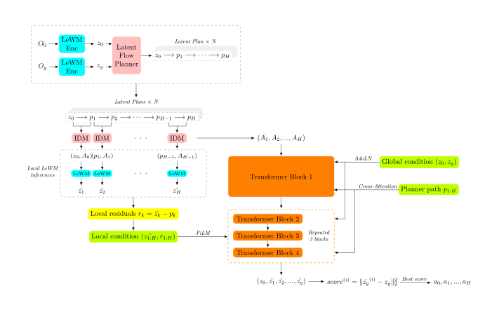
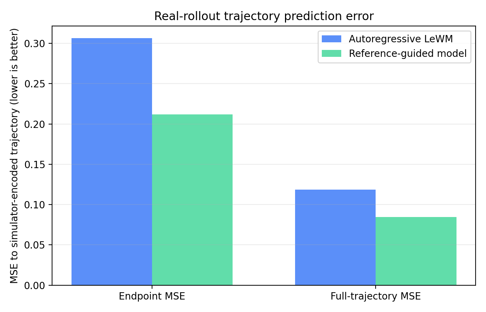
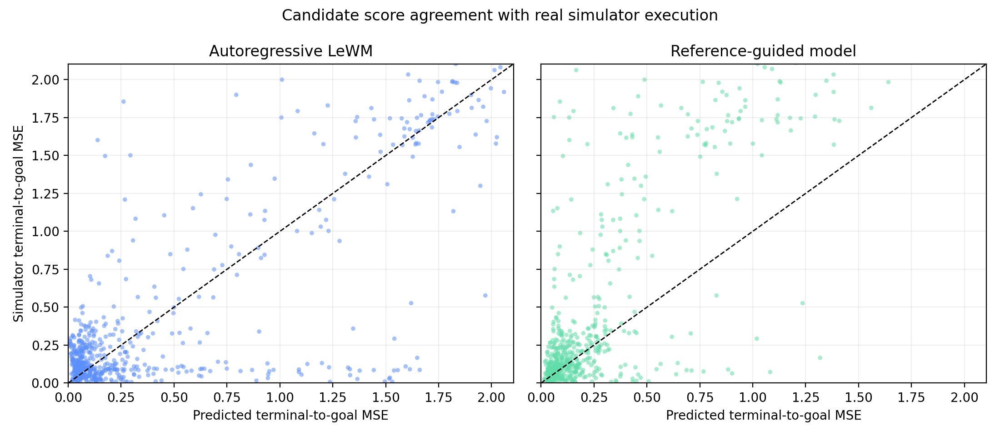

# 26/10/15

## New Architecture

### Evaluations

**Parameters: horizon=10, receding horizon=10, goal_offset_steps=50, budget=100**

| Seed | Original LeFlow | New LeFlow | success rate increase | Original time | New time | Δ time |
|---:|---:|---:|---:|---:|---:|---:|
| 42 | 80% | 94% | +14 pp | 35.796 s | 33.788 s | -2.008 s |
| 43 | 88% | 88% | 0 | 36.388 s | 34.127 s | -2.261 s |
| 44 | 84% | 90% | +6 pp | 35.828 s | 34.287 s | -1.541 s |
| 45 | 88% | 88% | 0 | 36.772 s | 35.127 s | -1.645 s |
| 46 | 82% | 86% | +4 pp | 36.473 s | 34.822 s | -1.651 s |
| 47 | 86% | 86% | 0 | 37.223 s | 35.116 s | -2.107 s |
| 48 | 74% | 88% | +14 pp | 36.000 s | 35.758 s | -0.242 s |
| 49 | 80% | 90% | +10 pp | 36.865 s | 35.514 s | -1.351 s |
| 50 | 86% | 88% | +2 pp | 37.814 s | 34.431 s | -3.383 s |
| 51 | 88% | 88% | 0 | 36.319 s | 34.004 s | -2.315 s |

**Overall:**

- Original LeFlow: $83.6\%\pm4.6\%$, max $88\%$

- New LeFlow: $88.6\%\pm2.3\%$, max $94\%$

| Metric | Original LeFlow | New LeFlow | Increase |
|---|---:|---:|---:|
| Mean success | 83.60% | **88.60%** | **+5.00 pp** |
| Sample std. | 4.60% | **2.32%** | -49.6% |
| Successful episodes | 418 / 500 | **443 / 500** | **+25** |
| Failed episodes | 82 / 500 | **57 / 500** | -30.5% |
| Mean evaluation time | 36.548 s | **34.697 s** | **-1.851 s / seed** |
| Relative evaluation-time reduction | — | — | **-5.1%** |

### Architecture

### Training

1. Data generation: from expert dataset, generated by LeFlow planner & IDM & simulator

2. Training

### Analysis

#### 1. MSE

| Task | LeWM full MSE | new full MSE | LeWM final MSE | new final MSE |
|---:|---:|---:|---:|---:|
| 0 | 0.0862 | **0.0740** | 0.4838 | **0.3138** |
| 1 | 0.1151 | **0.0169** | 0.2588 | **0.0307** |
| 2 | **0.0572** | 0.1604 | **0.1690** | 0.3606 |
| 3 | 0.2462 | **0.0303** | 0.5370 | **0.0426** |
| 4 | 0.3154 | **0.3038** | 0.7019 | **0.6874** |
| 5 | 0.0432 | **0.0305** | 0.0855 | **0.0575** |
| 6 | 0.0280 | **0.0131** | 0.0766 | **0.0344** |
| 7 | 0.0670 | **0.0308** | 0.2174 | **0.1049** |
| 8 | 0.0378 | **0.0363** | 0.1211 | **0.1002** |
| 9 | 0.1904 | **0.1482** | 0.4130 | **0.3854** |
| **In total 640** | **0.1186** | **0.0844** | **0.3064** | **0.2117** |

#### 2. Correlation

| Task | LeWM Pearson | New Pearson | LeWM Spearman | New Spearman | LeWM selected true MSE | New selected true MSE | LeWM regret | New regret |
|---:|---:|---:|---:|---:|---:|---:|---:|---:|
| 0 | 0.673 | **0.691** | 0.753 | **0.765** | 0.0799 | **0.0344** | 0.0721 | **0.0266** |
| 1 | -0.379 | **0.517** | -0.493 | **0.491** | 0.2513 | **0.0888** | 0.2213 | **0.0588** |
| 2 | **0.689** | -0.090 | **0.782** | -0.276 | **0.0164** | 0.3557 | **0.0083** | 0.3476 |
| 3 | -0.027 | **0.215** | -0.250 | **0.178** | 0.0949 | **0.0203** | 0.0746 | **0.0000** |
| 4 | **0.793** | 0.692 | 0.721 | **0.765** | 1.0832 | **0.5670** | 0.7784 | **0.2621** |
| 5 | 0.425 | **0.598** | 0.501 | **0.541** | 0.0284 | **0.0165** | 0.0176 | **0.0057** |
| 6 | 0.533 | **0.552** | **0.588** | 0.539 | **0.0747** | 0.1680 | **0.0423** | 0.1357 |
| 7 | 0.140 | **0.745** | 0.031 | **0.592** | 0.2553 | **0.1482** | 0.2515 | **0.1443** |
| 8 | **0.893** | 0.824 | 0.476 | **0.623** | 0.0613 | **0.0236** | 0.0544 | **0.0166** |
| 9 | **0.922** | 0.884 | 0.824 | **0.854** | 0.1465 | **0.0636** | 0.1265 | **0.0437** |
| **Avg** | **0.466** | **0.563** | **0.393** | **0.507** | **0.2092** | **0.1486** | **0.1647** | **0.1041** |

#### Summary

| Metric | LeWM | New | Change |
|---|---:|---:|---:|
| Full rollout MSE | 0.1186 | 0.0844 | -28.8% |
| Final rollout MSE | 0.3064 | 0.2117 | -30.9% |
| Avg Pearson per task | 0.466 | 0.563 | +20.7% |
| Avg Spearman per task | 0.393 | 0.507 | +28.9% |
| Final MSE after selection | 0.2092 | 0.1486 | -29.0% |
| Selection regret | 0.1647 | 0.1041 | -36.8% |