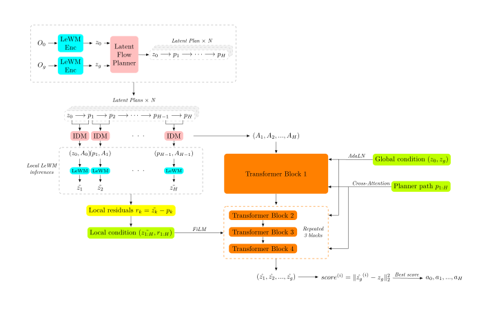
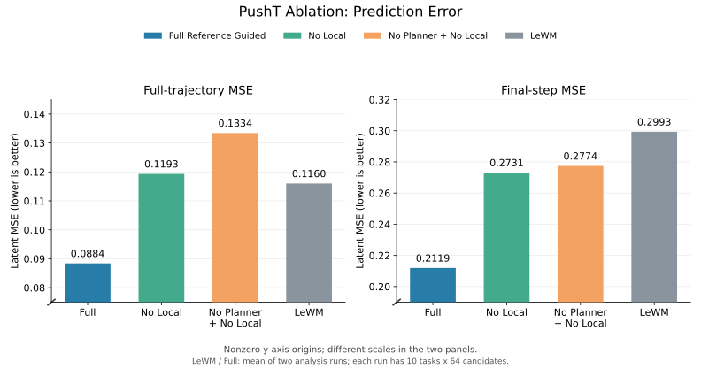
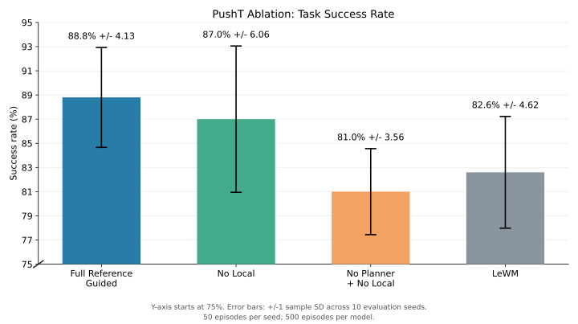

## 4 Tasks Evaluation

| Tasks | LeFlow SR | new LeFlow SR | SR increase | LeFlow time | new LeFlow time | time reduced |
|---|---:|---:|---:|---:|---:|---:|
| PushT | 82.60 ± 4.62% | **88.80 ± 4.13%** | **+6.20 pp** | 31.936 ± 0.821 | 30.724 ± 0.813 | 3.80% |
| TwoRooms | 98.60 ± 1.35% | **100.00 ± 0.00%** | **+1.40 pp** | 26.355 ± 2.275 | 22.061 ± 2.810 | 16.29% |
| Cube | 96.60 ± 2.84% | **98.20 ± 1.75%** | **+1.60 pp** | 79.170 ± 4.943 | 76.926 ± 5.731 | 2.83% |
| Reacher | 84.40 ± 5.64% | **87.80 ± 4.47%** | **+3.40 pp** | 55.319 ± 1.144 | 54.501 ± 1.418 | 1.48% |

## Ablations

### Ablation 1: No local conditions

**Model:**

- **Input:** $z_0, z_g, p_{1:H}$

### Ablation 2: No local conditions + no planner path

**Model:**

- **Input:** $z_0, z_g$

### Results

| Model | Full MSE ↓ | Final MSE ↓ | Success Rate | Full MSE Decrase | Final MSE Decrease | Success Rate Increase |
|---|---:|---:|---:|---:|---:|---:|
| Normal | **0.08840** | **0.21192** | **88.80 ± 4.13%** | +23.79% | +29.20% | +6.20 pp |
| No Local | 0.11933 | 0.27312 | 87.00 ± 6.06% | −2.87% | +8.76% | +4.40 pp |
| No Planner Path + No Local | 0.13344 | 0.27744 | 81.00 ± 3.56% | −15.03% | +7.31% | −1.60 pp |
| LeWM | 0.11600 | 0.29933 | 82.60 ± 4.62% | 0 | 0 | 0 |

